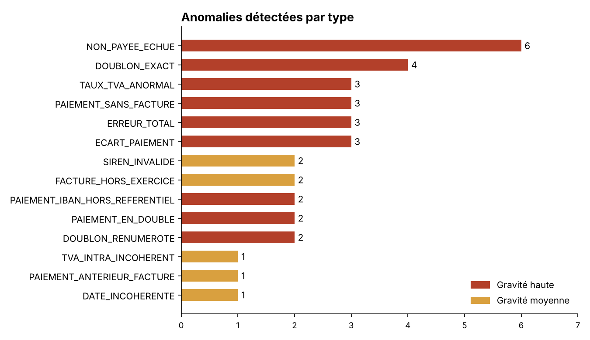
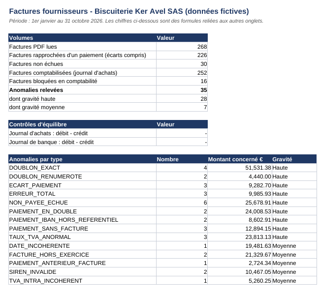
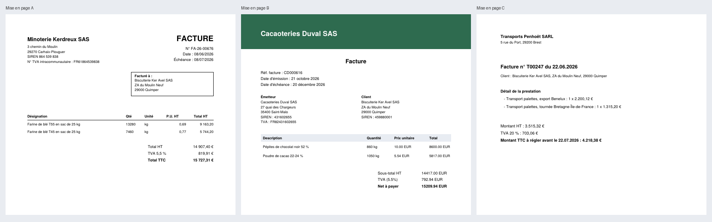

# Automatisation du traitement des factures fournisseurs avec Python

Chaîne de traitement complète : **extraction de données depuis des factures PDF**, contrôles de conformité, **rapprochement bancaire**, génération des **écritures comptables** et d'un rapport d'anomalies au format Excel.

> ⚠️ **Données 100 % fictives.** La société (Biscuiterie Ker Avel), ses 14 fournisseurs, leurs factures, leurs SIREN et IBAN et le relevé bancaire sont générés par le script `generer_factures.py`. Aucune donnée réelle d'entreprise n'est utilisée.

## Résultats

| | |
|---|---|
| Factures PDF traitées | 268 (3 mises en page, 14 fournisseurs, 2,02 M€ TTC) |
| Extraction des 10 champs de chaque facture | **100 %** (268 factures sur 268 sans aucune erreur) |
| Factures comptabilisées automatiquement | 252 (756 lignes d'écritures d'achats, journal équilibré) |
| Factures bloquées avant comptabilisation | 16 |
| Anomalies relevées | **35 sur 35 anomalies injectées, 0 fausse alerte** |

Les 35 anomalies représentent 28 de gravité haute et 7 de gravité moyenne. Les plus coûteuses :

| Anomalie | Nombre | Montant |
|---|---|---|
| Factures en doublon (même numéro, ou ré-émises sous un autre numéro) | 6 | 56 k€ |
| Factures échues et non payées | 6 | 25,7 k€ |
| Paiements effectués deux fois | 2 | 24 k€ |
| Taux de TVA anormal | 3 | 23,8 k€ |
| Paiements sans facture | 3 | 12,9 k€ |
| Virements sur un IBAN différent de celui du fournisseur (risque de fraude au RIB) | 2 | 8,6 k€ |



Le rapprochement bancaire relie 226 factures à leur paiement : 176 par numéro de facture et montant, 47 par montant seul (le libellé bancaire ne reprend pas toujours le numéro), 3 dont le montant payé diffère de celui de la facture. Les fournisseurs sont payés en moyenne 1,1 jour après l'échéance.



## Contexte

Dans une PME, le traitement des factures fournisseurs mobilise du temps (saisie, vérifications, rapprochement) et reste exposé aux erreurs et à la fraude : doublons, TVA mal appliquée, changement de RIB frauduleux, double paiement. Ce projet automatise la chaîne de bout en bout sur un jeu de données fictif.

Pour vérifier que les contrôles trouvent vraiment les anomalies, **35 anomalies de 13 types ont été cachées dans les données** : doublons exacts et renumérotés, erreurs de total, taux de TVA anormaux, SIREN et clés de TVA invalides, IBAN modifié, dates incohérentes, factures hors exercice, factures non payées, doubles paiements, paiements sans facture, écarts entre facture et paiement. Leur liste (`data/scenario_anomalies.csv`) sert uniquement de corrigé : les scripts de traitement ne la lisent jamais, seuls les contrôles de fin de script la comparent aux résultats.



## Démarche

| Étape | Script | Rôle |
|---|---|---|
| 1 | `generer_factures.py` | Génère les 268 factures PDF (3 mises en page), le relevé bancaire, le référentiel fournisseurs et le corrigé des anomalies |
| 2 | `extraire_factures.py` | Lit chaque PDF, reconnaît sa mise en page et en extrait les champs (fournisseur, SIREN, numéro, dates, HT, TVA, TTC, IBAN) |
| 3 | `controler_factures.py` | Applique les contrôles de conformité facture par facture et recherche les doublons |
| 4 | `rapprocher_banque.py` | Relie les paiements du relevé aux factures, puis détecte les anomalies de paiement |
| 5 | `produire_rapport.py` | Génère les écritures comptables, le classeur Excel et le graphique |

### Extraction (étape 2)

Chaque facture est lue avec **pdfplumber**. Les trois mises en page n'ont ni les mêmes libellés, ni les mêmes formats de date (`08/06/2026`, `21 octobre 2026`, `22.06.2026`), ni les mêmes formats de nombre (`14 907,40`, `14907.40`, `14.907,40`). Un jeu d'expressions régulières par mise en page convertit tout au même format. Le fournisseur est identifié par son nom dans le référentiel.

### Contrôles (étape 3)

| Contrôle | Principe |
|---|---|
| SIREN | Clé de Luhn |
| N° de TVA intracommunautaire | Clé calculée à partir du SIREN |
| IBAN | Clé de contrôle modulo 97, puis comparaison avec l'IBAN du référentiel |
| Totaux | HT + TVA = TTC, et TVA = HT x taux |
| Taux de TVA | Comparaison avec le taux habituel du fournisseur |
| Dates | Échéance postérieure à la date de facture, facture dans la période |
| Doublons | Même fournisseur et même numéro, ou mêmes date et montant sous un autre numéro |

### Rapprochement bancaire (étape 4)

Chaque paiement est rattaché à un fournisseur d'après son libellé, puis relié à une facture en quatre passes successives : numéro et montant identiques, montant identique seul, numéro avec un montant différent, enfin montant proche (à 20 % près) dans la fenêtre de paiement. Les paires sont choisies par ordre de proximité de date. Une fois les rapprochements faits, les opérations restantes sont qualifiées de paiements en double ou de paiements sans facture, et les factures échues sans paiement sont signalées.

### Écritures et rapport (étape 5)

Les factures sans anomalie bloquante sont comptabilisées au journal d'achats (charge, TVA déductible 44566, compte fournisseur 401). Les règlements passent au journal de banque (401 / 512). Les paiements sans facture vont au compte d'attente 471. Les factures en doublon, avec erreur de total, taux de TVA anormal, IBAN modifié ou hors exercice sont **bloquées** : elles ne sont ni comptabilisées ni payables tant qu'elles ne sont pas régularisées. Chaque anomalie du rapport est assortie d'une action recommandée.

## Livrables

- `resultats/rapport_factures.xlsx` : synthèse (formules), anomalies avec actions recommandées, suivi par facture, écritures d'achats et de banque, soldes fournisseurs
- `resultats/ecritures_comptables.csv` : écritures prêtes à importer (journal, date, pièce, compte, libellé, débit, crédit)
- `resultats/anomalies_factures.csv`, `anomalies_paiements.csv`, `rapprochement_factures.csv`, `operations_non_rapprochees.csv` : détail de chaque contrôle
- `resultats/*.txt` : compte rendu de chaque étape, avec la comparaison au corrigé
- `data/factures/` : les 268 factures PDF, `data/releve_bancaire.csv`, `data/fournisseurs.csv`

## Utilisation

```bash
pip install -r requirements.txt
python lancer_automatisation.py
```

Les données sont reproductibles (graine aléatoire fixe). Chaque script peut aussi être lancé seul, dans l'ordre des étapes.

## Structure

```
├── data/
│   ├── factures/                268 factures PDF
│   ├── releve_bancaire.csv
│   ├── fournisseurs.csv         référentiel (SIREN, IBAN, taux de TVA, compte de charge)
│   ├── factures_extraites.csv   résultat de l'extraction
│   ├── verite_extraction.csv    corrigé de l'extraction
│   └── scenario_anomalies.csv   corrigé des anomalies cachées
├── resultats/                   rapport Excel, écritures, anomalies, graphiques, comptes rendus
├── generer_factures.py
├── extraire_factures.py
├── controler_factures.py
├── rapprocher_banque.py
├── produire_rapport.py
├── lancer_automatisation.py     lance les 5 étapes
└── requirements.txt
```

## Limites et pistes d'amélioration

- **Les 100 % d'extraction sont obtenus sur des PDF que je génère moi-même**, avec trois mises en page connues. Sur de vraies factures, il faudrait gérer des documents scannés (OCR, par exemple Tesseract) et des mises en page inconnues, avec un taux d'erreur inévitablement plus élevé et une validation humaine des cas douteux.
- La détection des 35 anomalies est également favorisée par un jeu de données propre et sans ambiguïté. Le rapprochement bancaire repose sur des règles ajustées à ce jeu ; sur un relevé réel, plusieurs paiements groupés ou des libellés tronqués demanderaient des règles supplémentaires.
- Les écritures sont simplifiées : pas de factures multi-taux, pas de ventilation analytique, pas d'avoirs ni de TVA sur encaissements.
- Pistes : lecture des lignes de facture et rapprochement avec les bons de commande, calcul de l'échéancier de trésorerie, export au format d'import d'un logiciel comptable.

## Outils

Python · pdfplumber · ReportLab · openpyxl · Matplotlib · expressions régulières

## Auteur

**Zakaria El Idrissi**, diplômé de Brest Business School (programme grande école), en préparation de l'expertise comptable.
[LinkedIn](https://www.linkedin.com/in/zakaria-el-idrissi-bbs)
